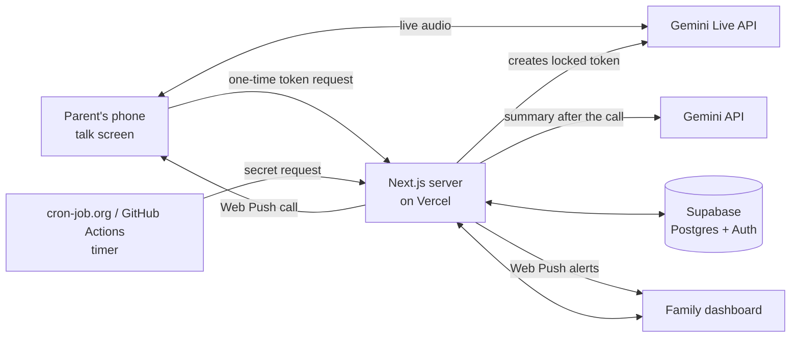

# خیریت · Khairiyat

**An AI companion that calls elderly parents every day, talks with them in Urdu, and keeps their family informed.**

Built for the Capital Youth Expo (CYE) 2026 Innovation Sprint Hackathon · Track: **Urdu & Regional Tech**

**Live demo:** https://khairiyat.vercel.app

## Team ByteBloom

| Name | Role |
|---|---|
| Ayesha Shabeer | Team Lead |
| Khadija Barki | Team Member |

## The problem

Many parents in Pakistan live alone or far from their children, who work in other cities or abroad. Their children worry: did Ammi take her medicine, is Abbu feeling well, would anyone know if something went wrong? Most apps expect an older person to type, read English and remember to open them.

Khairiyat asks them nothing but to **press one big button** and talk, in the language they speak at home.

> Khairiyat doesn't replace family. It brings families closer.

## Try it in 3 minutes

1. Open https://khairiyat.vercel.app and click **Open the demo**. No sign-up is needed. You'll see two demo parents with a week of sample data (labelled *Sample*).
2. Open **Ammi**, then **Open Ammi's talk screen** (or go to https://khairiyat.vercel.app/talk/demo-ammi).
3. Press **بات کریں**, allow the microphone (headphones help), and talk in Urdu. For example:
   - *"Raat ko neend nahi aayi, ghutne mein dard tha"*
   - *"Kisi ne phone kar ke OTP maanga tha"* (fraud warning)
   - *"Seene mein dard ho raha hai"* (emergency: help buttons appear and the dashboard shows an alert)
4. Press **بات ختم کریں**, then return to Ammi's dashboard. The new check-in appears within about 10 seconds.

To try the whole flow, create a family account, add a parent, open their QR link on a phone, install the app, allow calls, and click **Call now** on the dashboard.

## What it does

**For the parent**
- Real-time **voice conversation in Pakistani Urdu**; understands Punjabi (replies in Urdu by default); English can be chosen for each family member
- Speaks like a **daughter or a son**, with the right Urdu grammar for a mother or a father
- **Remembers previous days** ("Yesterday you mentioned knee pain, how is it today?")
- Asks about sleep, medicines (at the right time of day), pain, food and mood; never diagnoses or suggests new medicines
- Large Nastaliq Urdu screen with one button; installable as an app

**Safety**
- Watches for **22 situations** in two levels: 12 urgent (chest pain, stroke signs, a fall, breathing trouble, gas leak, intruder and more) and 10 concerns (fever, missed medicine, loneliness, fraud calls and more)
- Two layers of detection: the AI raises an alert itself (tool calling), and a keyword check in Roman Urdu and Urdu script backs it up
- Urgent situations show **one-tap buttons** for Rescue 1122 (police 15 for an intruder) and for calling the son or daughter, plus safety advice in Urdu
- The AI never calls emergency services by itself: a person decides

**For the family**
- Sign up, add parents (medicines, interests, daily call time, voice), and share a private link by QR code
- **Calls at medicine times**: each medicine can have its own time; Khairiyat also calls then and asks about that medicine
- Each call rings for 5 minutes (or 2, chosen for each family member), then shows as a missed call; after no answer or "Later", Khairiyat calls again 15 minutes after the first call and, if that one isn't answered either, tells the family
- **Daily call** at the chosen time, with a retry if unanswered and an alert on the dashboard if the retry is also unanswered; **Call now** button, which waits while a call is ringing or in progress and shows what is happening
- After each conversation: a short summary, scores (mood, sleep, pain, medicine, food) and a message preview
- The AI gathers those five in natural conversation; if the parent is unwell it asks about that first, and in an emergency it drops the report questions altogether
- **Notifications on the family's phone or computer** (optional, one tap to turn on): emergencies during the call, the summary after it, and unanswered calls
- Live alerts during the call, 7-day charts and history; the dashboard refreshes by itself
- **Voice messages**: the son or daughter records up to a minute; the parent hears it ("Ali ka paigham aaya hai") at the start of the next conversation, and the dashboard shows when it was heard
- **The parent can reply in their own voice**: a separate button on the talk screen records up to a minute and sends it straight to the family, who play it on the dashboard (never sent to the AI)
- **Warm, mobile-first design**: family member cards with optional photos, medicine reminders, a settings page and bottom navigation on phones
- **English / Urdu switch** on the family pages and the parent's screen (AI summaries, notifications and the spoken conversation are not switched)
- **Monthly report for the doctor**: averages, medicine days, warnings and a day-by-day table; print it or save it as PDF
- If the AI summary is unavailable, the check-in and its alerts are still saved and marked as needing attention

## How it works



1. The browser asks our server for a **single-use token**. The server locks the model, voice and instructions (including memory and medicines) into it, so the API key never reaches the browser.
2. Audio streams between the phone and Gemini Live. The AI calls a `raise_alert` tool when it hears something worrying.
3. After the call, the server asks Gemini for a summary in a fixed JSON shape, checks every field again, and saves **only the summary and scores**. If the AI is busy, a basic check-in is saved and the summary is retried.
4. A timer calls the scheduler every minute. It rings parents whose call time has arrived, using Web Push, and handles unanswered calls.

## Privacy and security

- **Khairiyat never stores conversation audio or transcripts.** The text is held in memory only to make the summary.
- A family voice message is saved: one per parent, readable only by that family's upload and that parent's talk link, and **erased once it has been played to the end**. It is not sent to the AI.
- A parent's voice message to the family is also saved: the newest 5 per parent, playable only by the signed-in family, which can delete them. It is not sent to the AI.
- Conversations are processed by **Google's Gemini API**. On the free tier, Google may use that content to improve its products, so please test with made-up conversations. A production service needs a paid tier with suitable data terms.
- The parent's consent is required when they are added, and the AI says it is an AI if asked.
- Database tables have Row Level Security on and give browser roles no access; only the server reads them, and every family page and action checks ownership.
- Family sign-in uses Supabase Auth with `httpOnly` cookies. Each parent's talk link holds a random 32-character token that the family can replace.
- API routes check the request origin, validate input and limit body size; push messages are only sent to known browser push services; rate limits are kept in memory (best effort on serverless hosting).
- Security headers block framing and restrict microphone use to this site. Error logs record the error type, never messages that could contain secrets.

## Current limits (prototype)

- Calls ring the **installed web app over the internet**. With the app closed, the phone shows a notification whose sound and vibration repeat every few seconds while the call rings; it is not a full-screen phone call, and some phones (battery savers) or Chrome's spam protection may delay, silence or hide it. Real phone-line calls are not built.
- Timer accuracy depends on the scheduling service: about a minute with a one-minute timer, longer if only the 5-minute GitHub Actions backup runs.
- Family alerts are **web notifications** (and appear on the dashboard). No WhatsApp or SMS is sent. They can be delayed or hidden by the phone or browser, and on iPhone web notifications need extra setup that this prototype doesn't provide. The shared demo account never sends them. An optional Telegram message exists in the code (one chat for the whole server, not enabled in the live demo).
- Gemini's spoken Punjabi sounds unnatural, so replies default to Urdu.
- A voice message plays only when the parent starts or answers a conversation. Recording formats differ between browsers, so a message may not play on some older phones.
- The doctor report is built from AI-made summaries and self-reported answers; it is not a medical record.
- The AI is not a medical device and can mishear or miss things. It must not be relied on for emergencies.

## Roadmap

- Calls to an ordinary phone line, so no smartphone or internet is needed
- WhatsApp summaries, and escalation from son to relative to neighbour
- Natural Pakistani Punjabi, Sindhi, Pashto and Saraiki voices

## APIs, services and libraries used

### External APIs and services
| Service | Used for |
|---|---|
| Google Gemini Live API (`gemini-3.8-live`) | Real-time voice conversation and alert tool calls |
| Google Gemini API (`gemini-3.5-flash-lite`, falling back to `gemini-3.5-flash`, `gemini-3.8-flash`) | Summaries and scores |
| Supabase (Postgres, Auth) | Database and family accounts |
| Web Push with VAPID, delivered by browser push services (for example Google FCM) | Ringing the parent's phone and alerting the family |
| cron-job.org | Runs the call scheduler |
| GitHub Actions | Backup scheduler |
| Telegram Bot API | Optional family message (disabled in the live demo) |
| Vercel | Hosting |
| Google Fonts (Noto Nastaliq Urdu, Geist) | Fonts, loaded through `next/font` and when generating icons |

Browser features used: Web Audio and AudioWorklet, microphone capture, MediaRecorder, printing to PDF, Service Worker, Push, Notifications, Vibration, BroadcastChannel, Web App Manifest.

### Libraries
| Package | Licence | Used for |
|---|---|---|
| next 16, react 19, react-dom 19 | MIT | Web app and server |
| @google/genai | Apache-2.0 | Gemini APIs |
| @supabase/supabase-js, @supabase/ssr | MIT | Database and sign-in |
| web-push | MPL-2.0 | Sending push messages |
| qrcode | MIT | QR codes for talk links |
| server-only | MIT | Keeps server code out of the browser |
| tailwindcss, @tailwindcss/turbopack | MIT | Styling |
| typescript | Apache-2.0 | Type checking |
| eslint, eslint-config-next | MIT | Code checks |
| tsx | MIT | Running tests |
| @types/node, @types/react, @types/react-dom, @types/qrcode, @types/web-push | MIT | Type definitions |

The project started from the `create-next-app` template. The charts are hand-written SVG.

### AI coding assistance
Developed with help from an AI coding assistant (Claude Code), which the competition rules permit.

## Run it locally

Needs Node.js 20.9 or newer, a free Gemini API key and a free Supabase project.

```bash
npm install
cp .env.example .env.local      # then fill in your values
npx web-push generate-vapid-keys # put the two keys in .env.local
```

1. In Supabase, open **SQL Editor** and run [`supabase/schema.sql`](supabase/schema.sql).
2. In **Authentication → Sign In / Providers → Email**, turn **Confirm email** off (prototype only).
3. Set a long random `DEMO_PASSWORD` and `CRON_SECRET` in `.env.local`.

```bash
npm run setup:demo   # demo account, demo parents and sample data
npm run dev          # http://localhost:3000
```

**Daily calls:** have a scheduler send a request to `/api/cron/tick` every minute with the header `Authorization: Bearer <CRON_SECRET>`.

## Tests

| Command | What it checks |
|---|---|
| `npm test` | 147 offline unit tests: safety rules, voice messages, the doctor report, script conversion, security helpers, push addresses, summary validation, saving calls when the AI fails, scheduling, AI instructions |
| `npm run test:e2e` | 26 checks of the family flow in a real Chrome browser, including another family being blocked (needs a running app; set `BASE_URL` to test a deployment) |
| `npm run test:ai` | 6 checks of a live Gemini conversation through the app (uses a little API quota) |

Also: `npm run lint` and `npm run build`.

## Project layout

```
src/app/            pages and API routes (talk screen, family dashboard, sign-in)
src/components/     UI for the parent's screen and the dashboard
src/lib/            AI instructions, safety rules, saving check-ins, calls, security
public/             service worker, microphone processor, app icons
supabase/           database schema
scripts/            demo data and icon generator
tests/              unit, browser and AI tests
```
